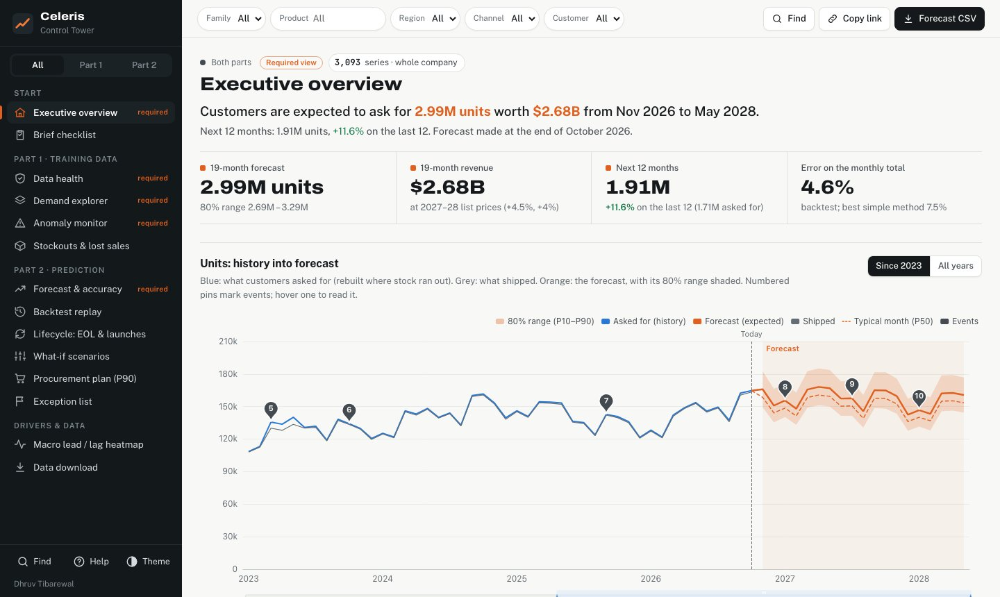
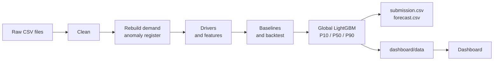
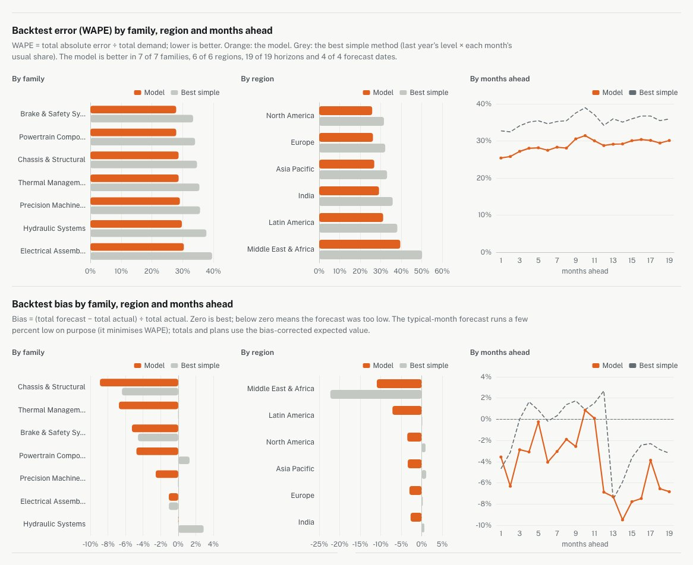
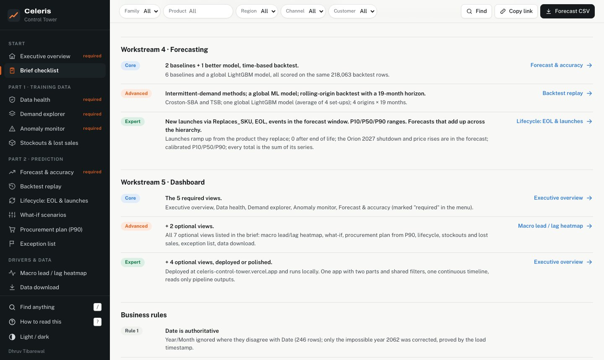
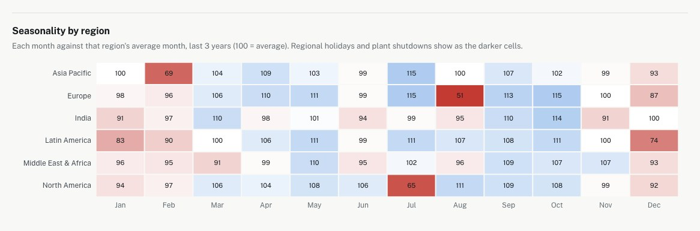

<div align="center">

# Celeris Demand Forecasting & Planning Control Tower

Cleaning, anomaly detection, a backtested demand forecast for **Nov 2026 – May 2028**
and an interactive planning dashboard for Celeris Automobili Industrial.

[](https://celeris-control-tower.vercel.app)


**[Live dashboard](https://celeris-control-tower.vercel.app)** ·
**[Forecast file](outputs/submission/submission.csv)** ·
**[Report](docs/REPORT.md)** ·
**[Quick start](#quick-start)**

</div>



## At a glance

| | |
|---|---|
| **Forecast** | [`outputs/submission/submission.csv`](outputs/submission/submission.csv): 58,219 rows, one for each row of `test.csv`, in the format of `sample_submission.csv` |
| **Accuracy** | **28.8%** WAPE per product, region and month, against 35.5% for the best simple method. **7.3%** on a family's monthly total, **4.6%** on the company's monthly total (backtest: 4 forecast dates × 19 months) |
| **Model** | One global LightGBM model for all 3,000+ series, a weighted average of five set-ups, with low / typical / high ranges (P10 / P50 / P90) |
| **Data cleaning** | 248,248 raw rows → 244,566 clean rows. 48 kinds of issue fixed, each one checked against a second source. Matches the independent stockout file on 5,762 of 5,762 rows |
| **Anomalies** | 18,770 unusual points logged with a type, a reason and an action |
| **Dashboard** | The 5 required views and all 7 optional views, shared filters, history and forecast on one timeline |
| **Reproducible** | `python run.py` rebuilds every output from the raw files. `python -m pytest` runs 118 checks |

## Quick start

### 1. See the results (nothing to install)

- Open the **[live dashboard](https://celeris-control-tower.vercel.app)**. Press `?` in the app for a short guide.
  The **Brief checklist** page links each requirement of the problem statement to the place where it is shown.
- The forecast is in [`outputs/submission/submission.csv`](outputs/submission/submission.csv).

### 2. Run the dashboard locally (Python only, no packages)

```bash
git clone https://github.com/dhruv-decoder/Celeris-Dashboard.git
cd Celeris-Dashboard
python3 -m http.server 8000 -d dashboard      # on Windows: python -m http.server 8000 -d dashboard
```

Open **http://localhost:8000**. It shows the same data as the live version: the files in `dashboard/data/` are
written by the pipeline (`python run.py export`). A local web server is needed because the page loads those
files; opening `index.html` directly from the folder does not work.

### 3. Rebuild everything from the raw data

Needs **Python 3.11 or newer** and the competition data, which is not included in this repository.

```bash
python3 -m venv .venv
source .venv/bin/activate                  # on Windows: .venv\Scripts\activate
pip install -r requirements.txt

# put the competition files in data/student_data/:
#   train.csv, test.csv, sku_master.csv, macro_indicators.csv,
#   events_calendar.csv, inventory_stockouts.csv, sample_submission.csv

python run.py                              # every step; the model steps take 30–45 min on a laptop
python -m pytest                           # 118 checks
python -m http.server 8000 -d dashboard    # the dashboard on the data you just built
```

- The new forecast is written to `outputs/submission/submission.csv` and checked against `test.csv` on every run.
  The dashboard data is refreshed in `dashboard/data/`.
- To run single steps: `python run.py <step> [<step> ...]`, for example `python run.py clean demand`.
- On a machine with more cores, `CELERIS_WORKERS=4 python run.py` trains the model steps in parallel. The
  results are the same.

## How it works



| Step | Command | What it does | Main outputs |
|---|---|---|---|
| Clean | `python run.py clean` | Reads every date format, unifies product, region, channel and customer names, removes reloaded records, fixes unit, price and currency errors, repairs the macro file | `outputs/clean/`, `outputs/reports/data_quality.json` |
| Demand | `python run.py demand` | Rebuilds what customers asked for where stock ran out (stockout file, chip shortage), estimates lost and missing months, builds the anomaly register, measures every calendar event | `outputs/demand/panel.parquet`, `outputs/reports/anomaly_register.csv`, `event_effects.csv` |
| Drivers | `python run.py drivers` | Which economic indicator leads which family, at what lag, and whether the link is stable. The shift to electric vehicles | `outputs/reports/macro_leadlag*.csv`, `ev_shift.csv` |
| Backtest | `python run.py backtest` | Six simple methods replayed at four past forecast dates, 19 months each | `outputs/reports/backtest_*.csv` |
| Features | `python run.py features` | Model inputs: history, ordering rhythm, demand class, calendar and holidays, events, lifecycle, growth, economy | `outputs/features/` |
| Model | `python run.py model_backtest model_final` | Backtests the model on the same rows as the simple methods, calibrates the ranges, then trains on all history and forecasts | `outputs/backtest/`, `outputs/forecast/` |
| Scenarios | `python run.py scenarios` | Re-runs the saved models with the economy shifted (what-if) | `outputs/reports/scenarios.json` |
| Insights | `python run.py insights` | Accuracy at planning levels, account changes, findings | `outputs/reports/accuracy_by_level.csv` |
| Submit | `python run.py submit` | Applies launch and end-of-life rules, checks the result against `test.csv`, writes the submission and the full forecast table | `outputs/submission/submission.csv`, `outputs/forecast/forecast.csv` |
| Export | `python run.py export` | Writes the dashboard's data files | `dashboard/data/*.json` |

### Key decisions

- **Prove before fixing.** A value is changed only when a second source (revenue ÷ price, the stockout file, load
  dates, the product master) shows what the true value is.
- **Forecast demand, not shipments.** In stockout months the model learns from what customers requested, so past
  shortages do not pull the forecast down. Missing months are estimated and left out of training.
- **No look-ahead.** At each backtest date the model is trained only on data known at that date. A test checks this.
- **New and retiring products.** A launch starts from the product it replaces (`Replaces_SKU`) and ramps up.
  A product is 0 after its end-of-life date.
- **Ranges for totals.** Ranges for families, regions and the company are calibrated on the backtest instead of
  adding up single-product ranges, which would make them far too wide.

## Results



### Every approach on the same backtest rows

| Approach | Method | WAPE |
|---|---|---|
| **Gradient boosting (chosen)** | **LightGBM, global, weighted average of 5 set-ups** | **28.8%** |
| Gradient boosting | XGBoost / CatBoost, same inputs | 29.9% / 30.0% |
| Deep learning | N-HiTS / N-BEATS | 32.1% / 33.4% |
| Pretrained time-series models | Chronos-2 / TimesFM 2.5 | 34.7% / 36.6% |
| Simple method | Last year's level × month-of-year pattern | 35.5% |
| Statistical | AutoETS / AutoARIMA | 38.6% / 39.0% |
| Intermittent demand | Croston / ADIDA / IMAPA | 51% |

Full table: [`experiments/results_model_comparison.csv`](experiments/results_model_comparison.csv).

- The model beats the best simple method in **every** family, region, month ahead, forecast date, channel and
  customer, and on 94.5% of individual series. It also wins on MAE (13.6 vs 16.7) and RMSE (25.3 vs 30.2).
- Blends with the other methods, with weights chosen on earlier forecast dates only, did not improve it.

### Accuracy at the levels planners work at

| Level | Model | Best simple method |
|---|---|---|
| One product, one region, one month | 29.2% | 35.5% |
| Family × region, per month | 9.3% | 13.3% |
| Family, per month | 7.3% | 10.0% |
| Region, per month | 6.1% | 10.2% |
| Whole company, per month | 4.6% | 7.5% |

### The forecast

- **2.99 M units** from Nov 2026 to May 2028 (80% range 2.69 – 3.29 M), about **$2.68 B** of revenue at the
  announced 2027 and 2028 prices.
- Known future events are included: Orion Driveline's North American plant shutdown in Jul–Aug 2027, the price
  rises and public holidays.

## Dashboard

**[celeris-control-tower.vercel.app](https://celeris-control-tower.vercel.app)**, or locally with
`python3 -m http.server 8000 -d dashboard`.

| Part | Views |
|---|---|
| Start | **Executive overview** · Brief checklist |
| Part 1 · Training data | **Data health** · **Demand explorer** · **Anomaly monitor** · Stockouts & lost sales |
| Part 2 · Prediction | **Forecast & accuracy** · Backtest replay · Lifecycle: EOL & launches · What-if scenarios · Procurement plan (P90) · Exception list |
| Drivers & data | Macro lead / lag heatmap · Data download |

Required views in **bold**.

- The **All / Part 1 / Part 2** switch above the menu shows every view, or only the views for one part of the brief.
- The same five filters (family, product, region, channel, customer) apply to every view. The address bar keeps
  them, so a copied link opens the same view with the same filters.
- History and forecast share one timeline, with the forecast marked and its P10–P90 range shaded.
- Every number comes from `dashboard/data/`, written by `python run.py export`. `tests/test_dashboard.py` checks
  those files against the pipeline outputs.

<table>
  <tr>
    <td width="50%"></td>
    <td width="50%"></td>
  </tr>
  <tr>
    <td align="center">Brief checklist: each requirement and where it is shown</td>
    <td align="center">Demand explorer: seasonality by region</td>
  </tr>
</table>

## Repository structure

```
Celeris-Dashboard/
├── run.py                   one command for the whole pipeline, with named steps
├── requirements.txt
├── celeris/                 pipeline code
│   ├── config.py, io.py     paths, constants, file reading and writing
│   ├── clean_sales.py       cleaning rules for the sales history
│   ├── clean_reference.py   product master, macro file, events, stockouts, test file
│   ├── quality.py           data-quality log
│   ├── demand.py            rebuilt demand: stockouts, chip shortage, missing months
│   ├── anomalies.py         anomaly register and event effects
│   ├── drivers.py           economic lead / lag, EV shift
│   ├── baselines.py         simple methods
│   ├── backtest.py          rolling backtest and scores
│   ├── features.py          model inputs
│   ├── model.py             global LightGBM, P10 / P50 / P90
│   ├── ranges.py            calibrated ranges for totals
│   ├── scenarios.py         what-if
│   ├── insights.py          accuracy by level, findings
│   ├── submission.py        lifecycle rules, checks, submission file
│   └── export.py            dashboard data
├── dashboard/               the app (index.html, app.js, app.css), its data and the report PDF
├── outputs/submission/      submission.csv
├── tests/                   pytest checks and two browser tests for the dashboard
├── experiments/             model experiments and their recorded results
└── docs/                    detailed write-ups and the images used here
```

All other outputs (`outputs/clean`, `outputs/demand`, `outputs/reports`, …) are rebuilt by `python run.py`.

## Testing

```bash
python -m pytest                    # 118 checks: cleaning rules, outputs, no look-ahead, model, dashboard data
python tests/ui_check.py            # opens every dashboard view in a headless browser (add "dark" for dark mode)
python tests/ui_interactions.py     # clicks through filters, search, sliders, replay and downloads
```

The two browser tests need Playwright: `pip install playwright && playwright install chromium`.

## Documentation

| Document | Contents |
|---|---|
| [REPORT.md](docs/REPORT.md) | The whole solution on a few pages |
| [CLEANING.md](docs/CLEANING.md) | Every data issue, how it was proved and how it was fixed |
| [DEMAND.md](docs/DEMAND.md) | Rebuilt demand, the anomaly register, event effects |
| [FORECASTING.md](docs/FORECASTING.md) | Backtest, simple methods, features, demand classes, economic drivers |
| [MODEL.md](docs/MODEL.md) | The model, the experiments, the comparison with other approaches, ranges |
| [DASHBOARD.md](docs/DASHBOARD.md) | Every view, ranges for totals, what-if, testing |

## AI use declaration

The idea, the thought process and the overall work (problem analysis, data investigation, modelling decisions and
dashboard design) are by Dhruv Tibarewal, developed during the MKS AI & Data Hackathon period. AI coding assistance
was used for implementation work.

---

<div align="center">

**Dhruv Tibarewal** · MKS AI & Data Hackathon

The data is synthetic and was provided for the hackathon. It is not included in this repository.

</div>
